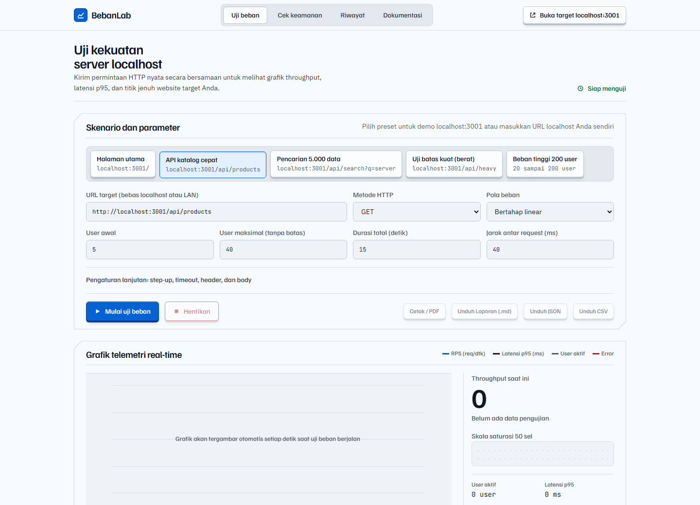

# BebanLab

**Workbench uji beban HTTP (*load & stress testing*), diagnosis titik down otomatis, dan audit header keamanan berbasis Node.js murni (nol dependensi eksternal) — dilengkapi website target demo terisolasi dan antarmuka Hallmark Cobalt.**




---

## Kenapa BebanLab?

Banyak alat uji beban hanya memuntahkan angka teknis mentah (`p95`, `RPS`, `ETIMEDOUT`) yang membingungkan pemula maupun klien non-teknis. **BebanLab** mengukur lalu lintas HTTP nyata secara langsung dan menyajikannya dalam **dua lapis penjelasan**:
1. **Penjelasan Utama dalam Bahasa Sederhana** — menggunakan analogi antrean dan kapasitas nyata agar langsung dipahami siapa saja.
2. **Pendukung Teknis & Data Valid** — persentil latensi, *successful throughput*, distribusi error aktual, serta langkah perbaikan konkret.

---

## Fitur Utama

- **Uji Beban Real-Time Tanpa Batas Artifisial:**
  - Atur bebas `User awal`, `User maksimal`, `Durasi (detik)`, `Jarak antar request (ms)`, dan `Timeout (ms)` untuk localhost maupun jaringan lokal.
  - 3 pola beban: **Bertahap linear (`ramp`)**, **Bertangga (`step`)** dengan interval kustom, dan **Konstan (`constant`)**.
  - Mendukung metode `GET`, `POST`, `PUT`, `PATCH`, `DELETE`, custom headers, dan payload body.
- **Grafik & Telemetri Langsung (SSE):**
  - Grafik `<canvas>` *dual-series* interaktif dengan *crosshair tooltip* (RPS, latensi `p95`, user aktif, dan penanda error per detik).
  - Meteran saturasi 50 sel monospace + konsol log telemetri per detik via Server-Sent Events (`/api/test/stream`).
- **Diagnosis Otomatis Titik Down & Solusi:**
  - Mendeteksi secara faktual: *Kapasitas Aman Terakhir*, *Mulai Melambat (`p95 > 500 ms`)*, *Error Pertama*, *Titik Jenuh (`p95 > 1000 ms` / error > 1%)*, *Mayoritas Gagal (`>= 50%`)*, dan *Down Total (`0` sukses)*.
  - Memberikan rekomendasi perbaikan spesifik sesuai gejala (`ETIMEDOUT`, `ECONNREFUSED`/`ECONNRESET`, `HTTP 429`, `HTTP 5xx`).
- **Audit Header Keamanan HTTP (`Cek keamanan`):**
  - Memeriksa 8 perlindungan dasar (`HTTPS & HSTS`, `CSP`, `Anti-Clickjacking`, `MIME Sniffing`, `Referrer-Policy`, `Permissions-Policy`, `Kebocoran Info Server`, `Keamanan Cookie`) lengkap dengan perbandingan mode aman (`?hardened=1`).
- **Perbandingan Riwayat & Ekspor Lengkap:**
  - Bandingkan 2 sesi pengujian berdampingan (**A vs B**) lengkap dengan selisih `p50`, `p95`, puncak sukses RPS, dan tingkat error.
  - Ekspor gabungan (data uji beban + analisis + solusi + audit keamanan) ke **Cetak / PDF**, **Laporan Markdown (`.md`)**, **JSON**, dan **CSV (UTF-8 BOM untuk Excel)**.
- **Target Demo Localhost Terisolasi (`port 3001`):**
  - Berjalan di proses terpisah via `child_process.fork()` agar pengukuran tidak bias, menyediakan endpoint ringan (`/api/products`), pencarian 5.000 item (`/api/search`), beban CPU nyata PBKDF2 (`/api/heavy`), dan `/health`.

---

## Cara Menjalankan

Prasyarat: **Node.js v20 atau lebih baru** (tidak perlu `npm install` karena tidak memakai paket pihak ketiga).

```bash
git clone https://github.com/Supermans21/Manstest.git
cd Manstest
npm start
```

Setelah dijalankan:
- **Dashboard BebanLab:** `http://localhost:3000`
- **Website Target Demo:** `http://localhost:3001`

*(Jika port `3000` atau `3001` sedang digunakan aplikasi lain, BebanLab otomatis berpindah ke port kosong berikutnya.)*

---

## Pengujian & Validasi

Jalankan seluruh unit test dan integration test bawaan Node.js:

```bash
npm test
```

Jika memiliki `.hallmark-kit`, jalankan linter desain UI Hallmark:

```bash
npm run lint:ui
```

---

## Dokumentasi Lanjutan

- [Arsitektur & Desain Sistem](docs/ARCHITECTURE.md)
- [Referensi REST & SSE API](docs/API.md)

---

## Struktur Proyek

```text
bebanlab/
├── .github/workflows/ci.yml   # GitHub Actions CI (Node 20 & 22)
├── docs/
│   ├── API.md                 # Dokumentasi endpoint REST & SSE
│   ├── ARCHITECTURE.md        # Penjelasan arsitektur & isolasi proses
│   ├── screenshot-dashboard.png
│   └── screenshot-target.png
├── public/
│   ├── index.html             # UI utama 4 tab (Uji beban, Audit, Riwayat, Dokumentasi)
│   ├── target.html            # Halaman web katalog demo target (port 3001)
│   ├── app.js                 # State client, SSE listener, compare runs, & exporters
│   ├── charts.js              # Grafik Canvas dual-series + tooltip interaktif
│   ├── styles.css             # Styling sistem Cobalt (Hallmark app screen)
│   ├── tokens.css             # Token warna oklch & tipografi
│   └── base.css               # Reset & aturan aksesibilitas dasar
├── scripts/
│   └── generate-pdf-report.mjs# Generator laporan PDF A4 berbasis data JSON
├── src/
│   ├── start.mjs              # Launcher dengan auto-port & fork proses target
│   ├── bench-server.mjs       # HTTP server dashboard, SSE, & penyimpanan riwayat
│   ├── target-server.mjs      # Server demo terisolasi (port 3001)
│   ├── load-engine.mjs        # Mesin load test konkuren & engine diagnosis 2 lapis
│   └── security-audit.mjs     # Pemeriksa 8 header keamanan HTTP aktual
├── tests/
│   └── bebanlab.test.mjs      # Automated test suite (node:test)
├── LICENSE
└── package.json
```

---

## Etika Penggunaan

Gunakan BebanLab **hanya pada `localhost`, lingkungan staging milik sendiri, atau domain publik yang telah memberikan izin tertulis**. Pengujian beban berulang ke server pihak ketiga dapat memicu firewall/rate limiter dan merugikan layanan orang lain.
